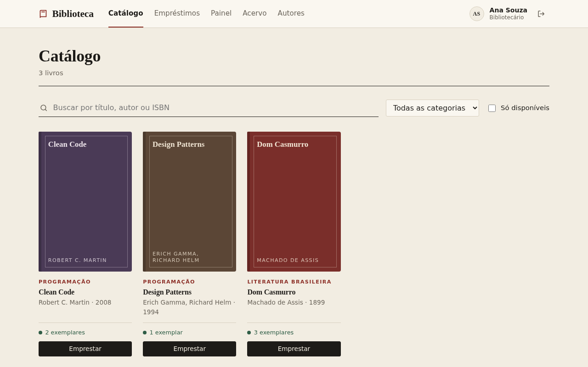
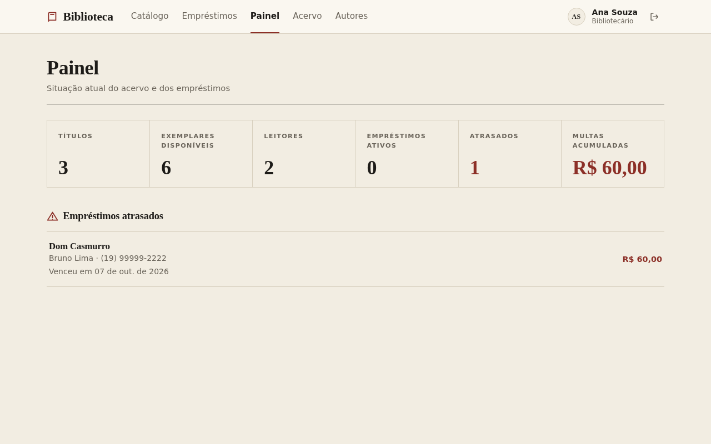
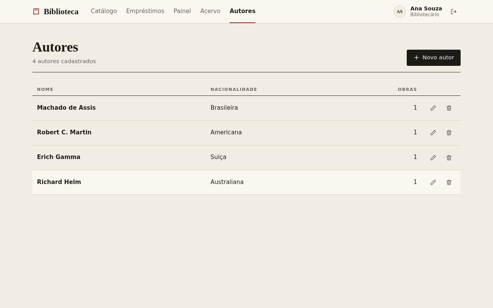
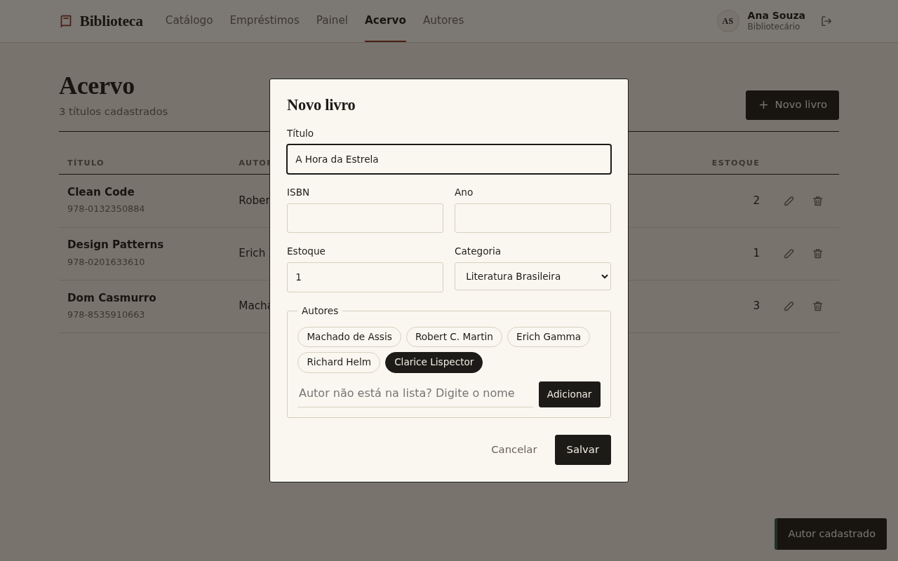
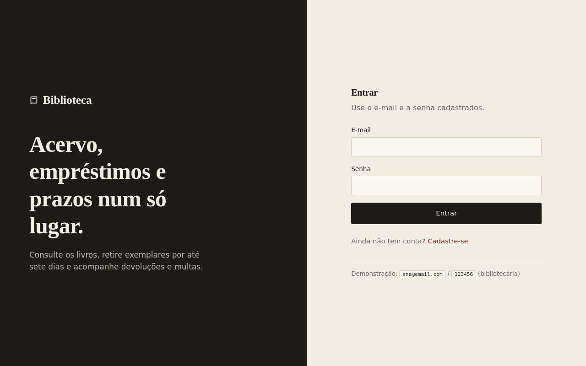
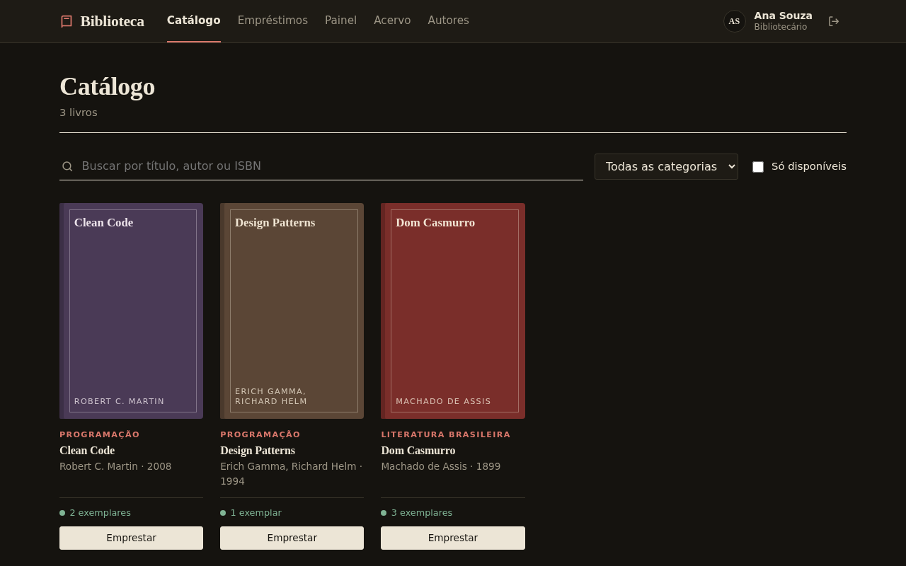
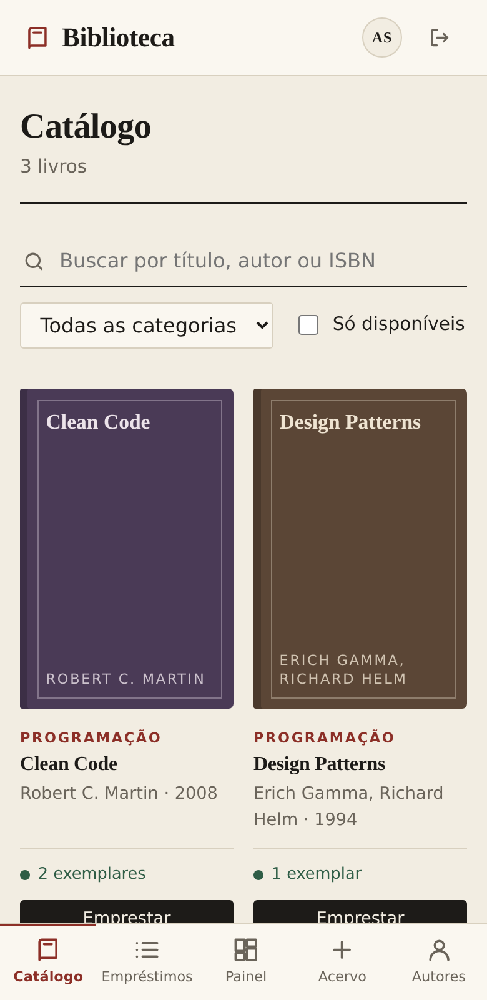

<div align="center">

# 📚 Biblioteca

**Sistema de gestão de acervo e empréstimos**<br>
API REST em Node.js + front-end responsivo, com controle de estoque, prazos e multas.


[**Abrir o sistema**](https://biblioteca.servidorcaseiro.online) · [Referência da API](docs/API.md) · [Arquitetura](docs/ARQUITETURA.md) · [Deploy](docs/DEPLOY.md)

<br>



</div>

---

## Sobre

A **Biblioteca** permite consultar o acervo, emprestar e devolver livros e acompanhar prazos e multas. Leitores usam o catálogo; bibliotecários administram livros, autores e empréstimos e acompanham tudo por um painel.

O projeto foi feito como uma **API em camadas** (rotas → controllers → services → repositories) com autenticação JWT, regras de negócio no servidor e um front-end em TypeScript puro, sem framework.

## Funcionalidades

**Para leitores**
- Catálogo com busca por título, autor ou ISBN, filtro por categoria e por disponibilidade
- Empréstimo com um clique, prazo de 7 dias
- Acompanhamento de prazos, histórico e multas; devolução pelo próprio sistema
- Criação de conta sem custo

**Para bibliotecários**
- Cadastro, edição e exclusão de **livros**
- Cadastro, edição e exclusão de **autores**, inclusive um cadastro rápido de autor dentro do formulário de livro
- Painel com títulos, exemplares, leitores, empréstimos ativos, atrasos e multas acumuladas
- Lista de atrasados com o telefone do leitor
- Empréstimo em nome de qualquer usuário

**Regras de negócio**
- No máximo **3 empréstimos em aberto** por usuário
- Só empresta com **estoque**; o estoque sobe e desce sozinho
- Atraso gera multa de **R$ 2,00 por dia**
- Livro que já foi emprestado e autor que ainda tem livros **não podem ser excluídos**

## Telas

<table>
  <tr>
    <td width="50%"><br><sub><b>Painel</b> com estatísticas e atrasos</sub></td>
    <td width="50%"><br><sub><b>Autores</b> com o número de obras de cada um</sub></td>
  </tr>
  <tr>
    <td width="50%"><br><sub><b>Novo livro</b> com cadastro rápido de autor</sub></td>
    <td width="50%"><br><sub><b>Entrar</b> ou criar conta</sub></td>
  </tr>
  <tr>
    <td width="50%"><br><sub><b>Tema escuro</b> automático</sub></td>
    <td width="50%" align="center"><br><sub><b>Celular</b> com navegação inferior</sub></td>
  </tr>
</table>

## Tecnologias

| | |
|---|---|
| **API** | Node.js 22, Express 5, `pg` (PostgreSQL), `jsonwebtoken` |
| **Banco** | PostgreSQL 18 |
| **Front-end** | TypeScript, Vite 8, CSS puro (sem framework) |
| **Segurança** | JWT, senhas com `scrypt`, perfis de acesso, escape automático de HTML |
| **Deploy** | Docker (multi-stage), nginx, Dokploy |
| **Testes** | Coleção Postman/Newman com 52 verificações |

## Começando

### Com Docker (mais rápido)

```bash
docker network create biblioteca
docker run -d --name pg --network biblioteca -e POSTGRES_PASSWORD=pg -e POSTGRES_DB=biblioteca postgres:18

docker build -t biblioteca .
docker run -d --name biblioteca --network biblioteca -p 3000:3000 \
  -e DATABASE_URL=postgresql://postgres:pg@pg:5432/biblioteca \
  -e JWT_SECRET=$(openssl rand -hex 32) biblioteca
```

Abra <http://localhost:3000>.

### Sem Docker

Requisitos: **Node.js 22.12+** e um **PostgreSQL** acessível.

```bash
git clone https://github.com/TGuiDev/entrega-api-nivaldo.git
cd entrega-api-nivaldo

createdb -U postgres biblioteca          # uma única vez
cp .env.example .env                     # ajuste PGPASSWORD e JWT_SECRET

npm install
npm run build                            # compila o front-end
npm start                                # http://localhost:3000
```

Para desenvolver com recarga automática, use dois terminais: `npm run dev` (API) e `npm run front:dev` (front em <http://localhost:5173>).

As tabelas e os dados de exemplo são criados na primeira execução.

### Acesso de demonstração

| Perfil | E-mail | Senha |
|---|---|---|
| Bibliotecária | `ana@email.com` | `123456` |
| Leitor | `bruno@email.com` | `123456` |

> ⚠️ Em produção, troque essas senhas ou apague as contas. Veja [Segurança](docs/DEPLOY.md#segurança).

## Variáveis de ambiente

| Variável | Descrição |
|---|---|
| `DATABASE_URL` | Conexão com o PostgreSQL. Alternativa: `PGHOST`, `PGPORT`, `PGUSER`, `PGPASSWORD`, `PGDATABASE` |
| `JWT_SECRET` | Segredo dos tokens. **Obrigatório em produção** (`openssl rand -hex 32`) |
| `PORT` | Porta HTTP (padrão `3000`) |

## Uma olhada na API

```bash
# entrar
TOKEN=$(curl -s -X POST localhost:3000/auth/login -H 'Content-Type: application/json' \
  -d '{"email":"ana@email.com","senha":"123456"}' | jq -r .token)

# cadastrar um autor
curl -X POST localhost:3000/autores -H "Authorization: Bearer $TOKEN" \
  -H 'Content-Type: application/json' -d '{"nome":"Clarice Lispector","nacionalidade":"Brasileira"}'

# buscar livros disponíveis
curl 'localhost:3000/livros?busca=clean&disponivel=true' -H "Authorization: Bearer $TOKEN"
```

| Recurso | Rotas |
|---|---|
| Autenticação | `POST /auth/login` · `POST /auth/registrar` · `GET /auth/me` |
| Livros | `GET /livros` · `GET /livros/{id}` · `POST /livros` · `PUT /livros/{id}` · `DELETE /livros/{id}` |
| Autores | `GET /autores` · `GET /autores/{id}` · `POST /autores` · `PUT /autores/{id}` · `DELETE /autores/{id}` |
| Empréstimos | `GET /emprestimos` · `GET /emprestimos/atrasados` · `POST /emprestimos` · `PUT /emprestimos/{id}/devolucao` |
| Outros | `GET /categorias` · `GET /usuarios` · `GET /estatisticas` · `GET /api/saude` |

Todos os detalhes, com exemplos de requisição, resposta e erros, estão na **[Referência da API](docs/API.md)**.

## Testes

Duas formas de exercitar a API:

- [`requisicoes.http`](requisicoes.http): exemplos para a extensão **REST Client** do VS Code, com login automático.
- [Coleção do Postman](postman/API_Biblioteca.postman_collection.json): 31 requisições e 52 verificações automáticas. Para rodar pelo terminal:

  ```bash
  docker run --rm --network host -v "$PWD/postman":/etc/newman postman/newman \
    run API_Biblioteca.postman_collection.json --env-var baseUrl=http://localhost:3000
  ```

## Documentação

| Documento | Conteúdo |
|---|---|
| [Referência da API](docs/API.md) | Todos os endpoints, permissões, exemplos e códigos de erro |
| [Arquitetura](docs/ARQUITETURA.md) | Camadas, fluxo de uma requisição e decisões de projeto |
| [Banco de dados](docs/BANCO-DE-DADOS.md) | Diagrama entidade-relacionamento, tabelas e integridade |
| [Front-end](docs/FRONTEND.md) | Telas, estrutura, design e desenvolvimento |
| [Deploy](docs/DEPLOY.md) | Docker, Dokploy, variáveis de ambiente e segurança |
| [Diagrama de classes](docs/diagrama-classes.mmd) | Modelo de classes em Mermaid |

## Estrutura do projeto

```
├── src/              API (rotas, controllers, services, repositories, models)
├── frontend/         SPA em Vite + TypeScript
├── docs/             Documentação e imagens
├── postman/          Coleção de testes
├── requisicoes.http  Exemplos para o REST Client
└── Dockerfile        Imagem de produção
```

---

<div align="center">
<sub>Feito por <a href="https://github.com/TGuiDev">TGuiDev</a></sub>
</div>
