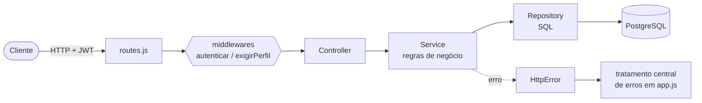

# Arquitetura

A API segue uma arquitetura em **camadas**, com responsabilidades separadas. O fluxo de uma requisição é sempre o mesmo:



## Camadas

| Camada | Responsabilidade | Exemplos |
|---|---|---|
| **Rotas** (`routes.js`) | Liga método + caminho a um controller e define quem pode acessar | `rotas.post('/autores', soBibliotecario, autorController.cadastrar)` |
| **Middlewares** | `autenticar` valida o JWT e preenche `req.usuario`; `exigirPerfil` restringe por perfil | `middlewares/auth.js` |
| **Controllers** | Recebem a requisição HTTP e devolvem a resposta com o status certo. Não têm regra de negócio | `LivroController`, `AutorController`, `EmprestimoController`, `AuthController` |
| **Services** | Regras de negócio e validações: limite de empréstimos, estoque, multa, duplicidade de autor | `LivroService`, `AutorService`, `EmprestimoService`, `AuthService` |
| **Repositories** | Único lugar que fala SQL. A classe base `Repository` implementa `findAll`, `findById`, `save` e `deleteById` para qualquer tabela | `LivroRepository`, `AutorRepository`, … |
| **Models** | Entidades com comportamento próprio (`Emprestimo.calcularMulta()`, `Livro.diminuirEstoque()`) | `models/*.js` |

Os métodos de services e repositories são assíncronos (`async/await`). Como o Express 5 repassa erros de handlers assíncronos ao tratador de erros, os controllers não precisam de `try/catch`.

## Estrutura de pastas

```
├── src/
│   ├── server.js         # inicializa o banco e sobe o servidor (porta 3000)
│   ├── app.js            # Express, arquivos estáticos do front, 404 e tratamento de erros
│   ├── routes.js         # todos os endpoints
│   ├── db.js             # pool de conexões, transações e init()
│   ├── schema.sql        # tabelas e dados de exemplo (idempotente)
│   ├── controllers/      # Auth, Livro, Autor, Emprestimo
│   ├── services/         # Auth, Livro, Autor, Emprestimo
│   ├── repositories/     # Repository (base), Livro, Autor, Categoria, Usuario, Emprestimo
│   ├── models/           # Usuario, Livro, Autor, Categoria, Emprestimo, Perfil, StatusEmprestimo
│   ├── middlewares/      # auth.js
│   └── utils/            # HttpError, senha (scrypt)
├── frontend/             # SPA em Vite + TypeScript (veja FRONTEND.md)
├── docs/                 # esta documentação
├── postman/              # coleção de testes
├── requisicoes.http      # exemplos para o REST Client
└── Dockerfile            # imagem de produção (API + front compilado)
```

## Decisões de projeto

**Autenticação por JWT.** O login devolve um token assinado (HS256, validade de 8 horas) com `id` e `perfil`. O servidor não guarda sessão. O segredo vem de `JWT_SECRET`; em produção (`NODE_ENV=production`) a API **se recusa a iniciar** sem ele, para que ninguém consiga forjar tokens com um valor padrão conhecido.

**Senhas com scrypt.** O hash usa `crypto.scryptSync` nativo do Node, com sal aleatório por usuário (`sal:hash`), e a comparação é feita em tempo constante. Sem dependências extras.

**Perfis.** `LEITOR` e `BIBLIOTECARIO`. O autocadastro só cria leitores, então o perfil nunca vem do cliente. O leitor é isolado dos dados dos outros: na listagem de empréstimos, o filtro por `usuarioId` é forçado para o próprio id.

**Transações.** Salvar um livro grava o livro e a lista de autores na mesma transação, para nunca ficar um livro "pela metade".

**Erros previsíveis.** Regras violadas lançam `HttpError(status, mensagem)`. O `app.js` converte isso em `{ "erro": "..." }`. Violações de chave estrangeira do PostgreSQL (`23503`) viram `409` com mensagem clara, em vez de um erro 500.

**Atrasos calculados sob demanda.** Não há tarefa agendada: ao listar empréstimos, a API marca como `ATRASADO` os ativos vencidos. A multa é sempre calculada na hora, a partir das datas.

**API e front juntos, mas separáveis.** Em desenvolvimento ou num único container, a API serve o build do front. Em produção neste projeto o front roda num container próprio (nginx) que repassa `/api` para a API; veja [Deploy](DEPLOY.md).

## Diagrama de classes

O diagrama completo está em [`diagrama-classes.mmd`](diagrama-classes.mmd) (formato Mermaid). Abra-o em <https://mermaid.live> para visualizar ou exportar em PNG/SVG.
