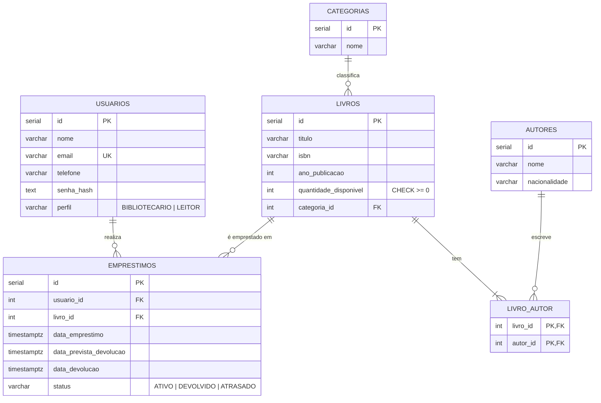

# Banco de dados

PostgreSQL. O esquema é criado e populado pelo arquivo [`src/schema.sql`](../src/schema.sql), que roda a cada inicialização do servidor. Ele é **idempotente**: usa `CREATE TABLE IF NOT EXISTS`, `ADD COLUMN IF NOT EXISTS` e só insere os dados de exemplo se a tabela estiver vazia. Reiniciar a API nunca apaga dados.

## Modelo de dados

## Tabelas

| Tabela | Finalidade |
|---|---|
| `usuarios` | Leitores e bibliotecários. A senha é guardada só como hash (`scrypt` com sal individual). E-mail único sem diferenciar maiúsculas (índice em `lower(email)`) |
| `autores` | Autores dos livros |
| `categorias` | Categorias do acervo |
| `livros` | Títulos e estoque. `quantidade_disponivel` nunca fica negativa (`CHECK`) |
| `livro_autor` | Relação muitos-para-muitos entre livros e autores |
| `emprestimos` | Histórico completo de empréstimos e devoluções |

## Integridade

| Regra | Como é garantida |
|---|---|
| Livro tem pelo menos um autor | Validação no `LivroService` (o SQL permite a relação vazia) |
| Excluir livro apaga seus vínculos de autoria | `livro_autor.livro_id ... ON DELETE CASCADE` |
| Não excluir livro que já foi emprestado | FK de `emprestimos.livro_id` sem cascade; a API traduz o erro `23503` em `409` |
| Não excluir autor que tem livros | FK de `livro_autor.autor_id` sem cascade; a API traduz o erro `23503` em `409` |
| Livro e autor gravados juntos | `LivroRepository.save` usa **transação** (livro + lista de autores) |
| Estoque nunca negativo | `CHECK (quantidade_disponivel >= 0)` |

## Dados de exemplo

Na primeira execução com tabelas vazias:

- **Usuários:** Ana Souza (`ana@email.com`, bibliotecária) e Bruno Lima (`bruno@email.com`, leitor). A senha de ambos é `123456`, definida na inicialização.
- **Autores:** Machado de Assis, Robert C. Martin, Erich Gamma e Richard Helm.
- **Categorias:** Literatura Brasileira e Programação.
- **Livros:** Dom Casmurro, Clean Code e Design Patterns.
- **Empréstimo:** um empréstimo de *Dom Casmurro* já vencido, para demonstrar atrasos e multas.

> Em produção, troque a senha da conta de demonstração ou apague o usuário. Veja [Deploy](DEPLOY.md#segurança).

## Conexão

Por `DATABASE_URL` ou pelas variáveis `PGHOST`, `PGPORT`, `PGUSER`, `PGPASSWORD` e `PGDATABASE`. Se `DATABASE_URL` estiver definida, ela tem prioridade.
